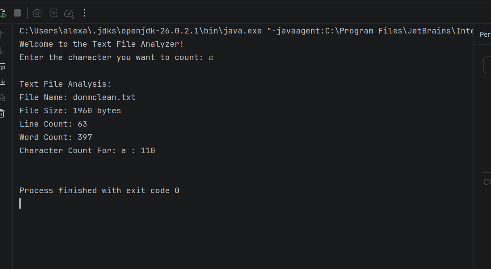
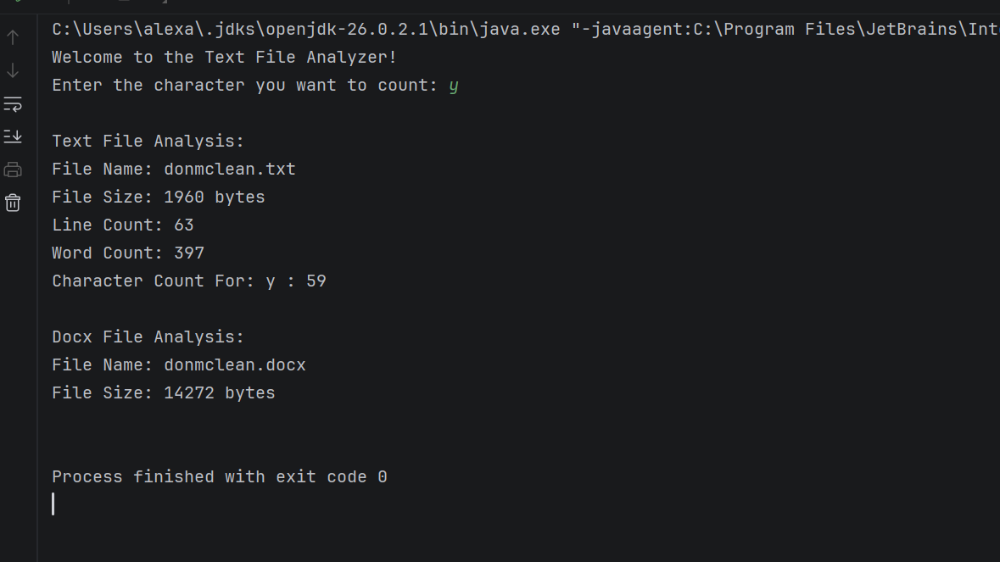
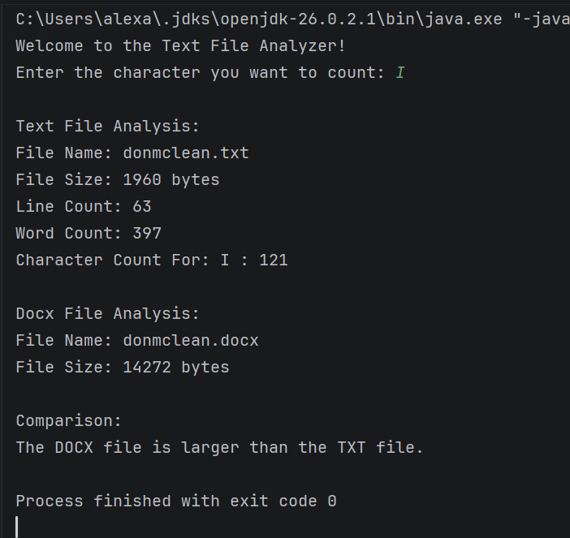

# Text File Analyzer

## Project Description

This is a program for a Java course that analyzes the contents of a plain .txt file and a .docx file. It reads both file types, counts lines and words, asks the user for a character (to search for), counts how many times the character is present in each file, shows the file sizes, and compares the overall size results between both files.

## How to Run

1. Open the project in IntelliJ.
2. Make sure the TXT and DOCX files to be analyzed ARE IN the project folder.
3. Run `TextFileAnalyzer.java`.
4. Enter a character to count.
5. Results from analysis of both files (TXT and DOCX) are displayed in the console.
6. Comparison of each file's size is displayed in the console, revealing which is larger.

## Files Being Analyzed

- TXT file: `donmclean.txt`
- DOCX file: `donmclean.docx`

## Screenshots

### TXT File Analysis ONLY

### TXT and DOCX Analysis

### Comparison Output Addition
